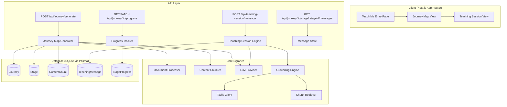
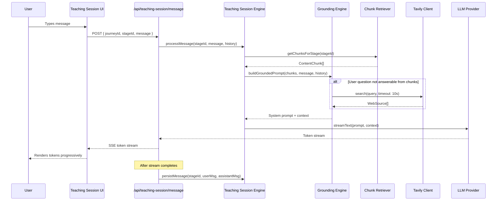
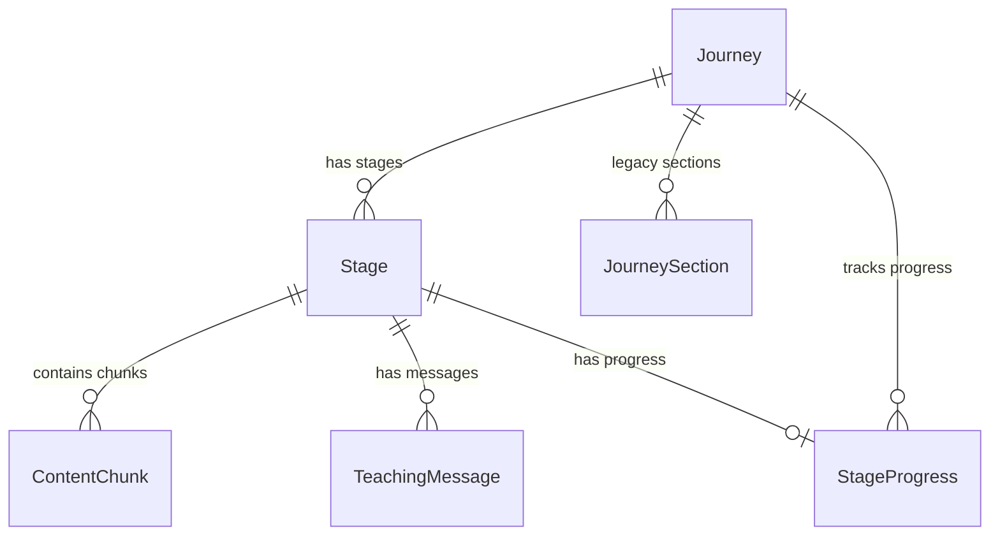

# Design Document: Interactive Journey Redesign

## Overview

This design transforms the "Teach Me" flow from a static article viewer into an immersive conversational learning adventure. The current system generates a flat list of text sections (via `JourneyViewer`) that users read passively. The redesign introduces:

1. **Visual Journey Map** — A connected path of themed stage nodes showing progression
2. **Interactive Teaching Sessions** — Chat-like conversations within each stage grounded in document content
3. **Content Chunking & Mapping** — Intelligent decomposition of documents into stage-aligned chunks
4. **Grounding Engine** — Anti-hallucination layer ensuring all responses cite documents or verified web sources (Tavily)
5. **Progress Tracking** — Persistent stage completion across sessions
6. **Conversation Persistence** — Saved chat histories per stage

The architecture extends the existing Next.js App Router application, Prisma/SQLite database, Vercel AI SDK integration, and Tavily web sourcing. The existing `curriculum-engine` is refactored into a `journey-map-generator` that produces stages (not flat sections), and a new `teaching-session-engine` handles conversational interactions.

### Design Decisions & Rationale

| Decision | Rationale |
|----------|-----------|
| Reuse Vercel AI SDK `streamText` for teaching sessions | Already in the stack (`ai` package), supports streaming, tool calling, and conversation history |
| SQLite for conversation persistence | Existing Prisma/SQLite setup; conversations are bounded per-stage, no need for a separate store |
| Content chunks stored as JSON in DB | Avoids a vector database dependency; semantic mapping is done at generation time by the LLM |
| Sequential stage unlocking as default | Preserves pedagogical ordering while keeping implementation simple |
| Server-sent events for journey generation | Matches existing pattern in `/api/journey/generate` |

---

## Architecture

### High-Level Architecture



### Low-Level Component Interaction (Teaching Session Flow)



---

## Components and Interfaces

### 1. Journey Map Generator (`src/lib/journey-map-generator/`)

Replaces the existing `curriculum-engine` for the new interactive flow. Responsible for analyzing document content, creating themed stages, chunking content, and mapping chunks to stages.

```typescript
// src/lib/journey-map-generator/index.ts

export interface Stage {
  id: string;
  journeyId: string;
  title: string;
  summary: string;          // 20-80 words
  theme: string;            // creative theme label
  order: number;            // sequential position
  topicsCovered: string[];  // list of topics/concepts in this stage
}

export interface ContentChunk {
  id: string;
  stageId: string;
  journeyId: string;
  content: string;          // 200-1000 words
  sourceDocument: string;   // filename of origin document
  sourceSection: string;    // original section title
  order: number;            // ordering within stage
}

export interface JourneyMap {
  id: string;
  topic: string;
  stages: Stage[];
  totalStages: number;
  createdAt: Date;
}

export interface GenerateJourneyMapParams {
  topic: string;
  documents?: ParsedDocument[];
  llmProvider: LLMProviderConfig;
  onProgress?: (event: JourneyProgressEvent) => void;
}

export async function generateJourneyMap(
  params: GenerateJourneyMapParams
): Promise<JourneyMap>;
```

### 2. Content Chunker (`src/lib/journey-map-generator/content-chunker.ts`)

Decomposes extracted document content into chunks of 200–1000 words while preserving paragraph boundaries.

```typescript
// src/lib/journey-map-generator/content-chunker.ts

export interface ChunkingOptions {
  minWords: number;    // default: 200
  maxWords: number;    // default: 1000
  overlapWords: number; // default: 50 (for context continuity)
}

/**
 * Splits document content into chunks preserving paragraph boundaries.
 * Pure function suitable for property-based testing.
 */
export function chunkDocumentContent(
  sections: ContentSection[],
  options?: Partial<ChunkingOptions>
): RawChunk[];

export interface RawChunk {
  content: string;
  wordCount: number;
  sourceSection: string;
  sourceDocument: string;
}
```

### 3. Teaching Session Engine (`src/lib/teaching-session-engine/`)

Manages conversational teaching within a stage. Handles message processing, grounding, streaming responses, and progress detection.

```typescript
// src/lib/teaching-session-engine/index.ts

export interface TeachingMessage {
  id: string;
  stageId: string;
  journeyId: string;
  role: 'user' | 'assistant';
  content: string;
  sources: MessageSource[];
  createdAt: Date;
}

export interface MessageSource {
  type: 'document' | 'web';
  name: string;
  url?: string;
}

export interface SendMessageParams {
  journeyId: string;
  stageId: string;
  message: string;
  llmProvider: LLMProviderConfig;
}

/**
 * Processes a user message and returns a streaming response.
 * Handles grounding, context assembly, and source attribution.
 */
export function createTeachingStream(
  params: SendMessageParams
): ReadableStream<Uint8Array>;

/**
 * Generates the initial teaching message when a user first opens a stage.
 */
export async function generateInitialMessage(
  journeyId: string,
  stageId: string,
  llmProvider: LLMProviderConfig
): Promise<ReadableStream<Uint8Array>>;

/**
 * Determines if all major topics in a stage have been covered.
 * Returns true when the teaching session should offer completion.
 */
export function assessStageCompletion(
  messages: TeachingMessage[],
  stage: Stage
): boolean;
```

### 4. Grounding Engine (`src/lib/teaching-session-engine/grounding-engine.ts`)

Ensures all LLM responses are traceable to document chunks or verified web sources.

```typescript
// src/lib/teaching-session-engine/grounding-engine.ts

export interface GroundedPrompt {
  systemPrompt: string;
  contextChunks: ContentChunk[];
  webSources: WebSource[];
  instructions: string;
}

export interface WebSource {
  title: string;
  url: string;
  content: string;
  retrievedAt: Date;
}

/**
 * Builds a grounded prompt by assembling relevant chunks and
 * optionally querying Tavily for supplementary sources.
 * 
 * Pure logic for prompt assembly (testable), with Tavily as injected dependency.
 */
export async function buildGroundedPrompt(
  stageChunks: ContentChunk[],
  userMessage: string,
  conversationHistory: TeachingMessage[],
  tavilySearch?: (query: string) => Promise<WebSource[]>
): Promise<GroundedPrompt>;

/**
 * Formats source attributions for display in the UI.
 * Pure function — maps sources to display labels.
 */
export function formatSourceAttribution(
  sources: MessageSource[]
): string;
```

### 5. Progress Tracker (`src/lib/progress-tracker/`)

Manages stage completion status and journey-level progress.

```typescript
// src/lib/progress-tracker/index.ts

export interface StageProgress {
  stageId: string;
  journeyId: string;
  status: 'locked' | 'unlocked' | 'in_progress' | 'completed';
  completedAt?: Date;
}

export interface JourneyProgress {
  journeyId: string;
  stages: StageProgress[];
  completedCount: number;
  totalStages: number;
  percentComplete: number;
}

/**
 * Gets the full progress state for a journey.
 * Stage 1 is always unlocked; subsequent stages unlock sequentially.
 */
export async function getJourneyProgress(
  journeyId: string
): Promise<JourneyProgress>;

/**
 * Marks a stage as completed and unlocks the next stage.
 */
export async function completeStage(
  journeyId: string,
  stageId: string
): Promise<StageProgress>;

/**
 * Computes the unlock status for all stages given completion data.
 * Pure function suitable for property-based testing.
 */
export function computeStageStatuses(
  stages: Stage[],
  completions: { stageId: string; completedAt: Date }[]
): StageProgress[];
```

### 6. API Routes

| Route | Method | Purpose |
|-------|--------|---------|
| `/api/journey/generate` | POST | Generate journey map (refactored, SSE stream) |
| `/api/journey/[id]` | GET | Fetch journey with stages |
| `/api/journey/[id]` | DELETE | Delete journey |
| `/api/journey/[id]/progress` | GET | Get journey progress |
| `/api/journey/[id]/stage/[stageId]/messages` | GET | Load conversation history |
| `/api/journey/[id]/stage/[stageId]/messages` | DELETE | Reset stage conversation |
| `/api/teaching-session/message` | POST | Send message in teaching session (SSE stream) |
| `/api/teaching-session/init` | POST | Generate initial teaching message (SSE stream) |
| `/api/teaching-session/complete` | POST | Mark stage as complete |

### 7. UI Components

| Component | Location | Purpose |
|-----------|----------|---------|
| `JourneyMap` | `src/components/journey/JourneyMap.tsx` | Visual path with stage nodes |
| `StageNode` | `src/components/journey/StageNode.tsx` | Individual milestone node |
| `ProgressIndicator` | `src/components/journey/ProgressIndicator.tsx` | Completion percentage display |
| `TeachingSession` | `src/components/journey/TeachingSession.tsx` | Chat-like teaching interface |
| `MessageBubble` | `src/components/journey/MessageBubble.tsx` | Individual chat message |
| `SourceLabel` | `src/components/journey/SourceLabel.tsx` | Source attribution badge |
| `CompletionCelebration` | `src/components/journey/CompletionCelebration.tsx` | Journey completion UI |

### 8. Zustand Store Extension

```typescript
// src/store/journey-store.ts (extended)

export interface InteractiveJourneyState {
  // ... existing state ...
  
  // New state for interactive journey
  currentStageId: string | null;
  stageMessages: Record<string, TeachingMessage[]>;
  journeyProgress: JourneyProgress | null;
  isTeaching: boolean;
  streamingMessage: string;
  
  // Actions
  setCurrentStage: (stageId: string) => void;
  addMessage: (stageId: string, message: TeachingMessage) => void;
  setStreamingMessage: (content: string) => void;
  updateProgress: (progress: JourneyProgress) => void;
}
```

---

## Data Models

### Prisma Schema Changes

```prisma
// Existing model (preserved for backward compatibility)
model Journey {
  id        String           @id @default(cuid())
  topic     String
  createdAt DateTime         @default(now())
  sections  JourneySection[] // Legacy sections
  stages    Stage[]          // New interactive stages
  progress  StageProgress[]
  isInteractive Boolean     @default(true) // false for legacy journeys
}

// Existing model (kept for legacy support)
model JourneySection {
  id              String  @id @default(cuid())
  journeyId       String
  title           String
  content         String
  order           Int
  sourceTag       String
  confidenceLevel String?
  attributionName String?
  attributionUrl  String?
  quizData        String?
  journey         Journey @relation(fields: [journeyId], references: [id], onDelete: Cascade)
  @@index([journeyId])
}

// New models for interactive journey
model Stage {
  id            String          @id @default(cuid())
  journeyId     String
  title         String
  summary       String
  theme         String
  order         Int
  topicsCovered String          // JSON array of topic strings
  journey       Journey         @relation(fields: [journeyId], references: [id], onDelete: Cascade)
  chunks        ContentChunk[]
  messages      TeachingMessage[]
  progress      StageProgress?
  
  @@index([journeyId])
  @@unique([journeyId, order])
}

model ContentChunk {
  id             String @id @default(cuid())
  stageId        String
  journeyId      String
  content        String
  sourceDocument String
  sourceSection  String
  order          Int
  wordCount      Int
  stage          Stage  @relation(fields: [stageId], references: [id], onDelete: Cascade)
  
  @@index([stageId])
  @@index([journeyId])
}

model TeachingMessage {
  id        String   @id @default(cuid())
  stageId   String
  journeyId String
  role      String   // 'user' | 'assistant'
  content   String
  sources   String?  // JSON array of MessageSource objects
  createdAt DateTime @default(now())
  stage     Stage    @relation(fields: [stageId], references: [id], onDelete: Cascade)
  
  @@index([stageId])
  @@index([journeyId, stageId])
}

model StageProgress {
  id          String    @id @default(cuid())
  stageId     String    @unique
  journeyId   String
  status      String    // 'locked' | 'unlocked' | 'in_progress' | 'completed'
  completedAt DateTime?
  stage       Stage     @relation(fields: [stageId], references: [id], onDelete: Cascade)
  journey     Journey   @relation(fields: [journeyId], references: [id], onDelete: Cascade)
  
  @@index([journeyId])
  @@unique([journeyId, stageId])
}
```

### Key Data Relationships



---


## Correctness Properties

*A property is a characteristic or behavior that should hold true across all valid executions of a system — essentially, a formal statement about what the system should do. Properties serve as the bridge between human-readable specifications and machine-verifiable correctness guarantees.*

### Property 1: Content chunking respects word count bounds and paragraph boundaries

*For any* document content composed of paragraphs, the `chunkDocumentContent` function SHALL produce chunks where every chunk has a word count between 200 and 1000 (inclusive), and no chunk splits a paragraph mid-sentence (chunk boundaries align with paragraph breaks).

**Validates: Requirements 3.1**

### Property 2: No orphaned chunks after stage assignment

*For any* set of content chunks produced from document processing, every chunk SHALL have a non-empty `stageId` assignment — no chunk exists without being mapped to at least one stage.

**Validates: Requirements 3.3**

### Property 3: Sequential stage unlock logic

*For any* journey with N stages and a set of completed stage IDs, the `computeStageStatuses` function SHALL produce statuses where: stage 1 is always unlocked or completed; stage K (K > 1) is unlocked only if stage K-1 is completed; and no stage after the first incomplete stage is unlocked.

**Validates: Requirements 4.5, 8.3**

### Property 4: Stage structure validation

*For any* generated journey map, the number of stages SHALL be between 10 and 15 (inclusive), and every stage SHALL have a summary whose word count is between 20 and 80 (inclusive).

**Validates: Requirements 2.1, 2.3**

### Property 5: Topic coverage completeness

*For any* set of topics extracted from uploaded documents and a generated journey map, every topic SHALL appear in the `topicsCovered` array of at least one stage — no topic from the source material is left unmapped.

**Validates: Requirements 2.4**

### Property 6: Progress percentage computation

*For any* journey with `totalStages > 0` and `completedCount` in the range `[0, totalStages]`, the computed `percentComplete` SHALL equal `Math.round((completedCount / totalStages) * 100)` and SHALL be in the range [0, 100].

**Validates: Requirements 4.7, 8.4**

### Property 7: Source attribution formatting

*For any* array of `MessageSource` objects, the `formatSourceAttribution` function SHALL produce output where: every document-sourced item is labeled as "Document" with its name, and every web-sourced item includes both a source name and a URL.

**Validates: Requirements 6.4, 7.3**

### Property 8: Unified content pool completeness

*For any* set of parsed documents, the unified content pool produced by combining their content SHALL contain every `ContentSection` from every document — no section is dropped during combination.

**Validates: Requirements 1.5**

### Property 9: Legacy journey migration produces valid stages

*For any* legacy journey with `JourneySection[]` entries, the migration function SHALL produce a valid `Stage[]` where: the number of stages equals the number of legacy sections (or fewer if consolidated), every stage has a non-empty title and summary, and stage ordering is sequential starting from 1.

**Validates: Requirements 11.2**

### Property 10: Grounded prompt includes stage chunk content

*For any* non-empty array of `ContentChunk` objects and a user message, the `buildGroundedPrompt` function SHALL produce a prompt whose context includes text from every provided chunk — no chunk is silently excluded from the grounding context.

**Validates: Requirements 6.1**

---

## Error Handling

### Error Categories

| Category | Scenario | Handling Strategy |
|----------|----------|-------------------|
| Document Parse Failure | Corrupted/unsupported file | Return error for specific file, continue processing others (Req 1.3) |
| LLM Unavailable | No provider configured or API error | Show user-friendly error with setup instructions |
| LLM Timeout | Generation exceeds 120s | Abort with partial results if available, or retry suggestion |
| Tavily Timeout | Web search exceeds 10s | Proceed with document-only content (Req 7.4) |
| Tavily Unavailable | API key missing or service down | Continue teaching from documents only, indicate web sources unavailable (Req 7.5) |
| Stage Not Found | Invalid stageId in URL | 404 page with navigation back to journey map |
| Journey Not Found | Invalid journeyId | 404 page with navigation to Teach Me entry |
| Message Send Failure | Network error during teaching | Retry button on failed message, preserve draft |
| Stream Interruption | SSE connection drops mid-response | Detect disconnect, offer to retry from last complete message |
| Database Error | Prisma/SQLite write failure | Log error, show generic "save failed" with retry |
| Validation Error | Invalid topic length, too many files | Inline form validation messages (existing pattern) |

### Error Response Format

All API routes follow the existing `handleApiError` pattern:

```typescript
{
  error: string;          // Human-readable message
  code: string;           // Machine-readable error code
  retryable?: boolean;    // Whether the client should offer retry
}
```

### Graceful Degradation Chain

1. **Full experience** — Documents + Tavily + LLM streaming
2. **No web sources** — Documents + LLM (Tavily fails/times out)
3. **No documents** — Tavily + LLM (topic-only journey)
4. **Partial generation** — Show completed stages even if later ones fail

---

## Testing Strategy

### Property-Based Tests (fast-check)

The project already uses `fast-check` with `vitest` for property-based testing. Each property from the Correctness Properties section maps to a dedicated property test file.

**Configuration:**
- Library: `fast-check` (already in devDependencies)
- Runner: `vitest --run --config vitest.config.property.ts`
- Minimum iterations: 100 per property
- Tag format: `Feature: interactive-journey-redesign, Property {N}: {title}`

**Property test files:**

| File | Properties Covered |
|------|-------------------|
| `src/lib/journey-map-generator/content-chunker.property.test.ts` | Property 1 (chunking bounds) |
| `src/lib/journey-map-generator/stage-assignment.property.test.ts` | Property 2 (no orphaned chunks), Property 5 (topic coverage) |
| `src/lib/progress-tracker/stage-unlock.property.test.ts` | Property 3 (sequential unlock) |
| `src/lib/journey-map-generator/stage-validation.property.test.ts` | Property 4 (stage structure) |
| `src/lib/progress-tracker/percentage.property.test.ts` | Property 6 (progress percentage) |
| `src/lib/teaching-session-engine/source-attribution.property.test.ts` | Property 7 (source formatting) |
| `src/lib/journey-map-generator/content-pool.property.test.ts` | Property 8 (unified pool) |
| `src/lib/journey-map-generator/legacy-migration.property.test.ts` | Property 9 (legacy migration) |
| `src/lib/teaching-session-engine/grounded-prompt.property.test.ts` | Property 10 (prompt includes chunks) |

### Unit Tests (vitest)

Focus on specific examples, edge cases, and error conditions:

- **Content chunker**: Empty input, single paragraph, paragraph at exact boundary (200/1000 words)
- **Stage unlock**: Zero stages, single stage, all complete, none complete
- **Progress calculation**: Division by zero guard, rounding behavior
- **Source attribution**: Empty sources array, mixed source types
- **Grounding engine**: Tavily timeout mock, empty chunks, very long conversation history truncation
- **Legacy migration**: Journey with 0 sections, journey with 50+ sections

### Integration Tests

- **Journey generation end-to-end**: Upload documents → generate → verify DB state
- **Teaching session flow**: Open stage → send message → verify streamed response → verify persistence
- **Progress persistence**: Complete stages → reload page → verify visual state
- **Conversation reset**: Send messages → reset → verify clean state

### Testing Balance

- Property tests verify universal correctness of pure functions (chunker, unlock logic, formatters)
- Unit tests cover specific edge cases and error paths
- Integration tests verify the full flow through API routes and database
- Manual testing covers UI responsiveness, animations, and visual design
