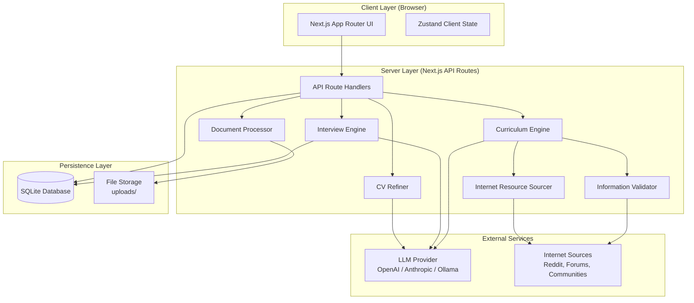
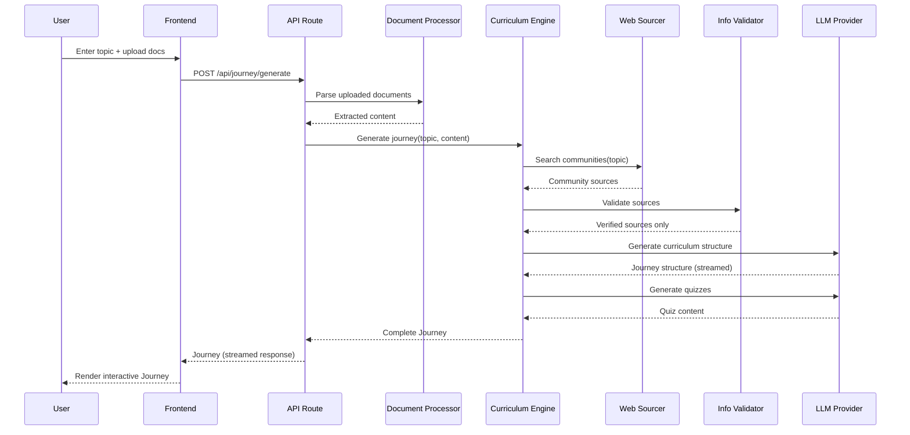
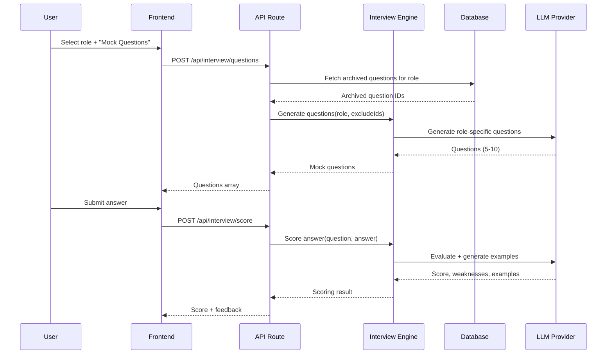
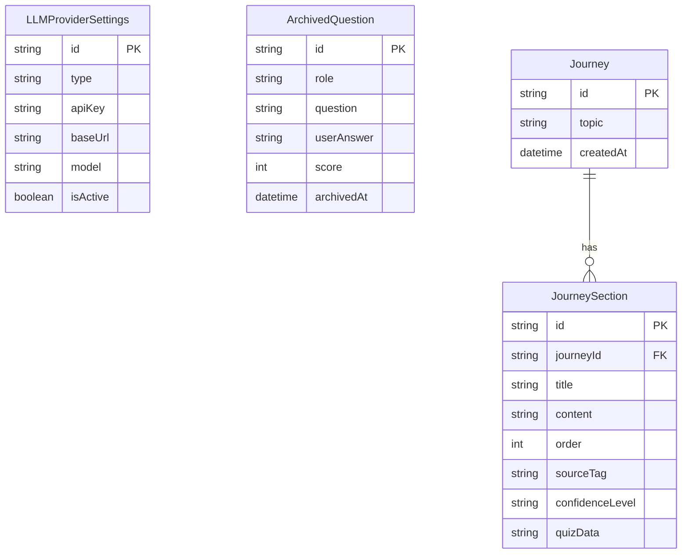

# Design Document: Learning Journey Platform

## Overview

The Learning Journey Platform is a full-stack web application that transforms documents and internet-sourced information into engaging, journey-style learning experiences. The platform serves two primary user flows:

1. **Teach Me** — Generates creative, non-linear learning curricula from uploaded documents and validated internet sources, with embedded quizzes and source attribution.
2. **Interview** — Provides role-specific mock interview questions, answer scoring with feedback, question archiving, and CV/resume refinement.

The platform is built with Next.js (App Router) for the frontend and API layer, uses the Vercel AI SDK for LLM provider abstraction (supporting OpenAI, Anthropic, Ollama Cloud, and Ollama Local), and employs a modular architecture with clear separation between document processing, content generation, information validation, and user interface layers.

### Key Design Decisions

| Decision | Choice | Rationale |
|----------|--------|-----------|
| Framework | Next.js 14+ App Router | Server Components reduce bundle size; API routes colocate backend logic; streaming support for LLM responses |
| LLM Abstraction | Vercel AI SDK | Unified provider API supporting OpenAI, Anthropic, and OpenAI-compatible endpoints (Ollama); eliminates boilerplate |
| Document Parsing | officeparser + epub2 | officeparser handles PDF/DOCX/XLSX/PPTX natively; epub2 covers EPUB format |
| Database | SQLite via Prisma | Zero-config local persistence for archives, settings; Prisma provides type-safe queries |
| Styling | Tailwind CSS + shadcn/ui | Consistent design system with WCAG AA compliance; responsive breakpoints |
| State Management | React Server Components + zustand (client) | Server-first with lightweight client state for interactive components |
| PDF Generation | @react-pdf/renderer | Generates downloadable refined CVs as PDF |

---

## Architecture

### High-Level System Architecture



### Request Flow: Teach Me Journey Generation



### Request Flow: Interview Mock Questions



---

## Components and Interfaces

### Project Structure

```
teachme/
├── src/
│   ├── app/                          # Next.js App Router
│   │   ├── layout.tsx                # Root layout
│   │   ├── page.tsx                  # Home screen
│   │   ├── teach-me/
│   │   │   ├── page.tsx              # Teach Me entry
│   │   │   └── journey/[id]/page.tsx # Journey viewer
│   │   ├── interview/
│   │   │   ├── page.tsx              # Interview entry
│   │   │   ├── mock/page.tsx         # Mock questions
│   │   │   ├── archive/page.tsx      # Question archive
│   │   │   └── cv/page.tsx           # CV refinement
│   │   ├── settings/
│   │   │   └── page.tsx              # LLM provider config
│   │   └── api/
│   │       ├── journey/
│   │       │   └── generate/route.ts
│   │       ├── interview/
│   │       │   ├── questions/route.ts
│   │       │   ├── score/route.ts
│   │       │   ├── archive/route.ts
│   │       │   └── cv/route.ts
│   │       ├── documents/
│   │       │   └── upload/route.ts
│   │       └── settings/
│   │           └── provider/route.ts
│   ├── lib/
│   │   ├── document-processor/
│   │   │   ├── index.ts              # Main parser orchestrator
│   │   │   ├── pdf-parser.ts
│   │   │   ├── docx-parser.ts
│   │   │   ├── epub-parser.ts
│   │   │   ├── xlsx-parser.ts
│   │   │   └── pptx-parser.ts
│   │   ├── curriculum-engine/
│   │   │   ├── index.ts              # Journey generation orchestrator
│   │   │   ├── journey-builder.ts    # Creative structure builder
│   │   │   ├── quiz-generator.ts     # Quiz embedding logic
│   │   │   └── source-integrator.ts  # Community content integration
│   │   ├── interview-engine/
│   │   │   ├── index.ts              # Interview orchestrator
│   │   │   ├── question-generator.ts # Mock question generation
│   │   │   ├── answer-scorer.ts      # Answer evaluation
│   │   │   └── cv-refiner.ts         # CV improvement logic
│   │   ├── information-validator/
│   │   │   ├── index.ts              # Validation orchestrator
│   │   │   ├── cross-reference.ts    # Multi-source verification
│   │   │   └── confidence-scorer.ts  # Confidence level assignment
│   │   ├── web-sourcer/
│   │   │   ├── index.ts              # Internet sourcing orchestrator
│   │   │   ├── reddit-searcher.ts    # Reddit API integration
│   │   │   └── community-searcher.ts # General forum search
│   │   ├── llm/
│   │   │   ├── provider.ts           # AI SDK provider factory
│   │   │   ├── config.ts             # Provider configuration
│   │   │   └── prompts.ts            # System prompts
│   │   ├── db/
│   │   │   ├── schema.prisma         # Database schema
│   │   │   ├── client.ts             # Prisma client singleton
│   │   │   └── migrations/
│   │   └── validators/
│   │       ├── topic.ts              # Topic input validation
│   │       ├── document.ts           # File upload validation
│   │       └── interview.ts          # Interview input validation
│   ├── components/
│   │   ├── ui/                       # shadcn/ui components
│   │   ├── journey/
│   │   │   ├── JourneyViewer.tsx
│   │   │   ├── JourneySection.tsx
│   │   │   ├── Quiz.tsx
│   │   │   └── SourceAttribution.tsx
│   │   ├── interview/
│   │   │   ├── QuestionCard.tsx
│   │   │   ├── AnswerInput.tsx
│   │   │   ├── ScoreDisplay.tsx
│   │   │   └── ArchiveList.tsx
│   │   ├── documents/
│   │   │   ├── FileUploader.tsx
│   │   │   └── FileList.tsx
│   │   └── settings/
│   │       └── ProviderConfig.tsx
│   └── store/
│       ├── journey-store.ts
│       └── interview-store.ts
├── prisma/
│   └── schema.prisma
├── public/
├── uploads/                          # Temporary file storage
├── next.config.js
├── tailwind.config.ts
├── tsconfig.json
└── package.json
```

### Component Interfaces (Low-Level Design)

#### Document Processor

```typescript
// src/lib/document-processor/index.ts

export interface ParsedDocument {
  id: string;
  fileName: string;
  format: SupportedFormat;
  content: DocumentContent;
  metadata: DocumentMetadata;
  parsedAt: Date;
}

export interface DocumentContent {
  sections: ContentSection[];
  rawText: string;
  headings: string[];
  totalCharacters: number;
}

export interface ContentSection {
  title: string;
  body: string;
  order: number;
  level: number; // heading depth (1-5)
}

export interface DocumentMetadata {
  title?: string;
  author?: string;
  pageCount?: number;
  wordCount: number;
}

export type SupportedFormat = 'pdf' | 'docx' | 'epub' | 'xlsx' | 'pptx';

export interface ParseResult {
  success: boolean;
  document?: ParsedDocument;
  error?: ParseError;
}

export interface ParseError {
  fileName: string;
  reason: string;
  code: 'UNSUPPORTED_FORMAT' | 'PARSE_FAILURE' | 'FILE_TOO_LARGE' | 'CORRUPTED';
}

/**
 * Orchestrates document parsing across supported formats.
 * Accepts a file buffer and delegates to the appropriate format-specific parser.
 */
export async function parseDocument(
  file: File,
  fileName: string
): Promise<ParseResult>;

/**
 * Parses multiple documents, returning results for each.
 * Continues processing remaining files even if individual files fail.
 */
export async function parseDocuments(
  files: File[]
): Promise<ParseResult[]>;

/**
 * Validates that a file meets upload requirements before parsing.
 */
export function validateUpload(file: File): {
  valid: boolean;
  error?: ParseError;
};
```

#### Curriculum Engine

```typescript
// src/lib/curriculum-engine/index.ts

export interface Journey {
  id: string;
  topic: string;
  sections: JourneySection[];
  totalSections: number;
  createdAt: Date;
  sources: SourceAttribution[];
}

export interface JourneySection {
  id: string;
  title: string;
  content: string;
  order: number;
  sourceTag: 'Document-sourced' | 'Internet-sourced';
  confidenceLevel?: 'High' | 'Medium' | 'Low';
  quiz?: Quiz;
  relatedSections: string[]; // IDs of connected sections (branching)
  attribution?: SourceAttribution;
}

export interface Quiz {
  id: string;
  questions: QuizQuestion[];
  sectionId: string;
}

export interface QuizQuestion {
  id: string;
  question: string;
  options: string[];
  correctAnswer: number;
  explanation: string;
}

export interface SourceAttribution {
  name: string;
  url?: string;
  type: 'document' | 'community' | 'forum' | 'article';
}

export interface JourneyGenerationParams {
  topic: string;
  documents?: ParsedDocument[];
  llmProvider: LLMProviderConfig;
}

/**
 * Generates a complete learning Journey from topic and optional documents.
 * Orchestrates document content extraction, internet sourcing, validation,
 * and LLM-based curriculum generation.
 * 
 * Returns a stream for progressive rendering.
 */
export async function generateJourney(
  params: JourneyGenerationParams
): Promise<Journey>;

/**
 * Builds creative, non-linear section ordering from extracted concepts.
 * Ensures ordering differs from source document TOC.
 */
export function buildJourneyStructure(
  concepts: ContentSection[],
  communitySources: VerifiedSource[]
): JourneySection[];

/**
 * Determines quiz insertion points (every 3-5 concepts).
 */
export function planQuizInsertion(
  sections: JourneySection[]
): QuizInsertionPlan;
```

#### Interview Engine

```typescript
// src/lib/interview-engine/index.ts

export interface MockQuestion {
  id: string;
  role: string;
  question: string;
  difficulty: 'medium' | 'hard';
  topicArea: string; // area with high failure rate
  createdAt: Date;
}

export interface AnswerScore {
  questionId: string;
  score: number; // 1-10
  weaknesses: Weakness[];
  exampleAnswers: ExampleAnswer[];
}

export interface Weakness {
  area: string;
  explanation: string;
}

export interface ExampleAnswer {
  styleName: string;
  content: string;
}

export interface ArchivedQuestion {
  id: string;
  role: string;
  question: string;
  userAnswer: string;
  score: number;
  archivedAt: Date;
}

/**
 * Generates mock interview questions for a role,
 * excluding previously archived questions.
 */
export async function generateMockQuestions(
  role: string,
  archivedIds: string[],
  llmProvider: LLMProviderConfig
): Promise<MockQuestion[]>;

/**
 * Scores a user's answer to a mock question.
 * Returns score (1-10), weaknesses (1-5), and 2 example answers.
 */
export async function scoreAnswer(
  question: MockQuestion,
  answer: string,
  llmProvider: LLMProviderConfig
): Promise<AnswerScore>;

/**
 * Archives a scored question with user's answer.
 */
export async function archiveQuestion(
  questionId: string,
  role: string,
  userAnswer: string,
  score: number
): Promise<ArchivedQuestion>;

/**
 * Retrieves all archived questions for a role.
 */
export async function getArchive(
  role: string
): Promise<ArchivedQuestion[]>;

/**
 * Removes a question from the archive, making it eligible for future sessions.
 */
export async function unarchiveQuestion(
  questionId: string
): Promise<void>;
```

#### CV Refiner

```typescript
// src/lib/interview-engine/cv-refiner.ts

export interface CVRefinementResult {
  success: boolean;
  refinedPdfBuffer?: Buffer;
  error?: string;
}

export interface CVContent {
  sections: CVSection[];
  rawText: string;
}

export interface CVSection {
  heading: string;
  content: string;
  type: 'experience' | 'education' | 'skills' | 'summary' | 'other';
}

/**
 * Parses an uploaded CV/resume document (PDF or DOCX).
 * Must complete within 30 seconds.
 */
export async function parseCV(
  file: File
): Promise<CVContent>;

/**
 * Generates a refined version of the CV tailored to the target role.
 * Preserves all factual data (dates, titles, companies, credentials, numbers).
 * Returns a downloadable PDF buffer.
 */
export async function refineCV(
  cvContent: CVContent,
  targetRole: string,
  llmProvider: LLMProviderConfig
): Promise<CVRefinementResult>;
```

#### Information Validator

```typescript
// src/lib/information-validator/index.ts

export interface VerificationResult {
  claim: string;
  verified: boolean;
  confidenceLevel: 'High' | 'Medium' | 'Low';
  sources: VerificationSource[];
  timedOut: boolean;
}

export interface VerificationSource {
  url: string;
  title: string;
  available: boolean;
}

export type SourceTag = 'Document-sourced' | 'Internet-sourced';

/**
 * Verifies a factual claim against independent sources.
 * Times out after 30 seconds, excluding unverified claims.
 * 
 * Confidence levels:
 * - High: verified by 3+ sources
 * - Medium: verified by 2 sources
 * - Low: verified by 1 source
 */
export async function verifyClaim(
  claim: string,
  timeout?: number // default 30000ms
): Promise<VerificationResult>;

/**
 * Cross-references LLM-generated content against source documents.
 * Confirms semantic alignment between generated claim and original text.
 */
export async function crossReferenceWithDocument(
  claim: string,
  sourceDocument: ParsedDocument
): Promise<{ aligned: boolean; matchedSection?: string }>;

/**
 * Batch verifies multiple claims in parallel.
 * Returns only verified claims with their confidence levels.
 */
export async function verifyBatch(
  claims: string[]
): Promise<VerificationResult[]>;
```

#### LLM Provider

```typescript
// src/lib/llm/provider.ts

import { createOpenAI } from '@ai-sdk/openai';
import { createAnthropic } from '@ai-sdk/anthropic';

export type ProviderType = 'openai' | 'anthropic' | 'ollama-cloud' | 'ollama-local';

export interface LLMProviderConfig {
  type: ProviderType;
  apiKey?: string;     // Required for cloud providers
  baseUrl?: string;    // Custom endpoint (Ollama local: http://localhost:11434)
  model: string;       // Selected model name
  timeout: number;     // Request timeout in ms (default 15000)
}

export interface ProviderValidationResult {
  valid: boolean;
  error?: string;
  availableModels?: string[];
}

/**
 * Creates an AI SDK provider instance based on configuration.
 * All providers use OpenAI-compatible API format.
 */
export function createProvider(config: LLMProviderConfig): AIProvider;

/**
 * Validates provider credentials by issuing a test request.
 * Must complete within 15 seconds for cloud, 10 seconds for local.
 */
export async function validateProvider(
  config: LLMProviderConfig
): Promise<ProviderValidationResult>;

/**
 * Retrieves available models from the configured provider.
 */
export async function listModels(
  config: LLMProviderConfig
): Promise<string[]>;
```

#### Input Validators

```typescript
// src/lib/validators/topic.ts

export interface ValidationResult {
  valid: boolean;
  error?: string;
}

/**
 * Validates topic input: 3-200 characters, non-empty.
 */
export function validateTopic(topic: string): ValidationResult;

// src/lib/validators/document.ts

const MAX_FILE_SIZE = 100 * 1024 * 1024; // 100 MB
const MAX_FILES_PER_SESSION = 20;
const SUPPORTED_FORMATS = ['pdf', 'docx', 'epub', 'xlsx', 'pptx'] as const;
const CV_FORMATS = ['pdf', 'docx'] as const;

/**
 * Validates file format and size for document upload.
 */
export function validateDocumentUpload(
  file: File,
  currentFileCount: number
): ValidationResult;

/**
 * Validates CV/resume upload (PDF/DOCX only).
 */
export function validateCVUpload(file: File): ValidationResult;

// src/lib/validators/interview.ts

/**
 * Validates role input: 2-100 characters.
 */
export function validateRole(role: string): ValidationResult;

/**
 * Validates answer length: minimum 20 characters.
 */
export function validateAnswer(answer: string): ValidationResult;
```

---

## Data Models

### Database Schema (Prisma)

```prisma
// prisma/schema.prisma

datasource db {
  provider = "sqlite"
  url      = env("DATABASE_URL")
}

generator client {
  provider = "prisma-client-js"
}

model LLMProviderSettings {
  id        String   @id @default(cuid())
  type      String   // 'openai' | 'anthropic' | 'ollama-cloud' | 'ollama-local'
  apiKey    String?  // encrypted, never displayed after entry
  baseUrl   String?
  model     String
  isActive  Boolean  @default(false)
  createdAt DateTime @default(now())
  updatedAt DateTime @updatedAt
}

model ArchivedQuestion {
  id         String   @id @default(cuid())
  role       String
  question   String
  userAnswer String
  score      Int      // 1-10
  archivedAt DateTime @default(now())

  @@index([role])
}

model Journey {
  id        String           @id @default(cuid())
  topic     String
  createdAt DateTime         @default(now())
  sections  JourneySection[]
}

model JourneySection {
  id              String  @id @default(cuid())
  journeyId       String
  title           String
  content         String
  order           Int
  sourceTag       String  // 'Document-sourced' | 'Internet-sourced'
  confidenceLevel String? // 'High' | 'Medium' | 'Low'
  attributionName String?
  attributionUrl  String?
  quizData        String? // JSON-serialized Quiz
  journey         Journey @relation(fields: [journeyId], references: [id])

  @@index([journeyId])
}
```

### Key Data Flow Models



---


## Correctness Properties

*A property is a characteristic or behavior that should hold true across all valid executions of a system — essentially, a formal statement about what the system should do. Properties serve as the bridge between human-readable specifications and machine-verifiable correctness guarantees.*

### Property 1: Input Length Validation

*For any* string input and a given validator configured with min/max bounds (topic: 3-200, role: 2-100, answer: 20-∞), the validator SHALL accept the string if and only if its trimmed length falls within the configured bounds, and reject it otherwise with the state unchanged.

**Validates: Requirements 2.3, 5.2, 6.6**

### Property 2: Document Upload Validation

*For any* file with a given extension and size, the upload validator SHALL accept the file if and only if its extension is one of {pdf, docx, epub, xlsx, pptx}, its size is ≤ 100 MB, and the current session file count is < 20. All three conditions must hold for acceptance.

**Validates: Requirements 1.1, 1.5**

### Property 3: Unsupported Format Error Message Completeness

*For any* file with an extension not in the set of accepted formats, the error response SHALL contain both the unsupported extension name and the complete list of accepted formats.

**Validates: Requirements 1.3, 8.2**

### Property 4: Batch Processing Resilience

*For any* batch of N documents where K documents are corrupted (0 ≤ K ≤ N), the processing result SHALL contain exactly (N - K) successful results and K error results, and each error result SHALL contain the corresponding file name.

**Validates: Requirements 1.4**

### Property 5: Journey Section Order Differs from Source

*For any* document with an ordered list of headings (length ≥ 2), the generated Journey's section ordering SHALL NOT be identical to the original heading order.

**Validates: Requirements 3.2**

### Property 6: Quiz Frequency Invariant

*For any* generated Journey with N sections (where N ≥ 5), the number of embedded quizzes Q SHALL satisfy: ⌈N/5⌉ ≤ Q ≤ ⌊N/3⌋. That is, at least one quiz per 5 concepts and at most one quiz per 3 concepts.

**Validates: Requirements 3.3**

### Property 7: Unverified Content Exclusion

*For any* set of information claims with associated verification results, the Journey output SHALL contain only claims where verified = true. No unverified claim shall appear in the final output.

**Validates: Requirements 3.6, 11.4**

### Property 8: Journey Section Metadata Completeness

*For any* section in a generated Journey, it SHALL have a sourceTag of exactly "Document-sourced" or "Internet-sourced". Additionally, if sourceTag is "Internet-sourced", the section SHALL have a non-empty attribution AND a confidence level of "High", "Medium", or "Low".

**Validates: Requirements 3.7, 4.4, 4.5**

### Property 9: Journey Section Count Bounds

*For any* generated Journey, the total section count S SHALL satisfy: 5 ≤ S ≤ 50.

**Validates: Requirements 3.8**

### Property 10: Confidence Level Assignment

*For any* number of verification sources N (where N ≥ 1), the confidence level SHALL be assigned as: High if N ≥ 3, Medium if N = 2, Low if N = 1.

**Validates: Requirements 4.5**

### Property 11: Answer Scoring Structural Invariants

*For any* scored answer response, the score SHALL be an integer in [1, 10], the weaknesses array SHALL have length in [1, 5] with each weakness having a non-empty explanation, and the exampleAnswers array SHALL have exactly 2 entries each with a distinct non-empty styleName.

**Validates: Requirements 6.2, 6.3, 6.4**

### Property 12: Mock Question Count Bounds

*For any* role, the generated mock question set SHALL contain between 5 and 10 questions (inclusive).

**Validates: Requirements 6.1**

### Property 13: Archive Exclusion

*For any* set of archived question IDs and a newly generated set of mock questions, the intersection of archived IDs and generated question IDs SHALL be empty.

**Validates: Requirements 6.5, 7.3**

### Property 14: Archive Round-Trip

*For any* question with associated answer and score, archiving the item and then querying the archive for that role SHALL return an item with the same question text, answer text, and score value.

**Validates: Requirements 7.1**

### Property 15: Unarchive Removes Item

*For any* archived question, calling unarchive followed by querying the archive SHALL result in that question no longer being present in the archive results.

**Validates: Requirements 7.6**

### Property 16: Archive Grouping by Role

*For any* set of archived questions across multiple roles, the grouping function SHALL produce groups where every item in a group has the same role, no item appears in more than one group, and all items appear in exactly one group.

**Validates: Requirements 7.5**

### Property 17: CV Format Validation

*For any* file uploaded in the CV refinement flow, the validator SHALL accept the file if and only if its extension is one of {pdf, docx}.

**Validates: Requirements 8.1**

### Property 18: CV Factual Data Preservation

*For any* CV document containing dates, job titles, company names, education credentials, and quantitative achievements, the refined output SHALL contain all of these factual elements exactly as they appeared in the original.

**Validates: Requirements 8.4**

### Property 19: Invalid API Key Not Stored

*For any* API key that fails provider validation, the key SHALL NOT be persisted in the database after the validation attempt.

**Validates: Requirements 9.8**

### Property 20: Community Quality Filter

*For any* set of community sources, the filter SHALL include only communities with member count ≥ 1000 AND last activity date within the past 12 months. All communities not meeting both criteria SHALL be excluded.

**Validates: Requirements 11.2**

### Property 21: Community Content Topic Matching

*For any* piece of community-sourced information with an associated topic, it SHALL be embedded within the Journey section whose topic most closely matches the sourced content's topic.

**Validates: Requirements 11.5**

---

## Error Handling

### Error Handling Strategy

The platform implements a layered error handling strategy with graceful degradation:

| Layer | Strategy | User Impact |
|-------|----------|-------------|
| Input Validation | Reject early with descriptive messages | Immediate feedback, no processing wasted |
| Document Parsing | Per-file isolation, continue on failure | Other files still process; error messages name the failed file |
| Information Validation | Timeout (30s), exclude unverified | Journey still generates without unverified content |
| LLM Provider | Timeout (15s), suggest alternative | User can switch provider or retry |
| Internet Sourcing | Timeout (30s), graceful degradation | Journey generates without community content; user notified |
| CV Refinement | Retain original on failure | User can retry; original never lost |
| Archive Operations | Database transaction rollback | Consistent state preserved |

### Error Types and Responses

```typescript
// src/lib/errors.ts

export class PlatformError extends Error {
  constructor(
    message: string,
    public code: ErrorCode,
    public userMessage: string,
    public retryable: boolean = false
  ) {
    super(message);
  }
}

export type ErrorCode =
  | 'UNSUPPORTED_FORMAT'
  | 'FILE_TOO_LARGE'
  | 'FILE_CORRUPTED'
  | 'MAX_FILES_EXCEEDED'
  | 'PARSE_FAILURE'
  | 'VALIDATION_TIMEOUT'
  | 'LLM_UNAVAILABLE'
  | 'LLM_INVALID_KEY'
  | 'LLM_TIMEOUT'
  | 'INTERNET_SOURCE_UNAVAILABLE'
  | 'CV_REFINEMENT_FAILED'
  | 'NO_QUESTIONS_AVAILABLE'
  | 'ANSWER_TOO_SHORT';

/**
 * Error boundary for API routes.
 * Catches PlatformError instances and returns structured JSON responses.
 */
export function handleApiError(error: unknown): NextResponse {
  if (error instanceof PlatformError) {
    return NextResponse.json(
      { error: error.userMessage, code: error.code, retryable: error.retryable },
      { status: getHttpStatus(error.code) }
    );
  }
  // Unexpected errors — log and return generic message
  console.error('Unexpected error:', error);
  return NextResponse.json(
    { error: 'An unexpected error occurred. Please try again.', retryable: true },
    { status: 500 }
  );
}
```

### Timeout Configuration

| Operation | Timeout | On Timeout |
|-----------|---------|------------|
| Document parsing | No timeout (local) | N/A — handles corruption via try/catch |
| Information validation (per claim) | 30 seconds | Exclude claim, proceed |
| LLM API key validation | 15 seconds (cloud), 10s (local) | Show error, suggest alternative |
| LLM content generation | 60 seconds | Show error, allow retry |
| Internet community search | 30 seconds | Proceed without community content |
| CV parsing | 30 seconds | Show error, retain original |

---

## Testing Strategy

### Testing Approach

The platform uses a dual testing approach:

1. **Property-based tests** — Verify universal correctness properties across randomly generated inputs (100+ iterations per property)
2. **Unit tests** — Cover specific examples, edge cases, and integration points
3. **Integration tests** — Verify component interactions and external service behavior

### Property-Based Testing

**Library:** [fast-check](https://github.com/dubzzz/fast-check) (TypeScript PBT library)

**Configuration:**
- Minimum 100 iterations per property test
- Each test tagged with: `Feature: learning-journey-platform, Property {number}: {title}`
- Tests focus on pure functions: validators, filters, structural invariants, round-trips

**Properties to implement as PBT:**

| Property | Test Target | Generator Strategy |
|----------|-------------|-------------------|
| P1: Input Length Validation | `validateTopic()`, `validateRole()`, `validateAnswer()` | Random strings of length 0-500 |
| P2: Document Upload Validation | `validateDocumentUpload()` | Random extensions, sizes (0-100MB), counts (0-30) |
| P3: Error Message Completeness | `validateDocumentUpload()` error paths | Random unsupported extensions |
| P4: Batch Processing Resilience | `parseDocuments()` | Random file arrays with corruption flags |
| P5: Journey Order Differs | `buildJourneyStructure()` | Random heading lists (2-50 items) |
| P6: Quiz Frequency | `planQuizInsertion()` | Random section counts (5-50) |
| P7: Unverified Exclusion | Content filter function | Random claim arrays with verified booleans |
| P8: Section Metadata | Journey section validation | Random section objects |
| P9: Section Count Bounds | Journey generation output | Various input sizes |
| P10: Confidence Assignment | `assignConfidence()` | Random source counts (0-10) |
| P11: Scoring Invariants | `scoreAnswer()` output validation | Random answer strings |
| P12: Question Count | `generateMockQuestions()` output | Random roles |
| P13: Archive Exclusion | Question generation with exclusion | Random ID sets |
| P14: Archive Round-Trip | Archive → Query cycle | Random question/answer/score tuples |
| P15: Unarchive Removes | Archive → Unarchive → Query | Random archived items |
| P16: Archive Grouping | `groupByRole()` | Random items across multiple roles |
| P17: CV Format Validation | `validateCVUpload()` | Random file extensions |
| P18: CV Data Preservation | `refineCV()` factual check | Random CV data with known facts |
| P19: Invalid Key Not Stored | Provider config after failed validation | Random invalid key strings |
| P20: Community Filter | `filterCommunities()` | Random community metadata |
| P21: Topic Matching | `matchContentToSection()` | Random content/section topic pairs |

### Unit Tests

Unit tests cover:
- Specific format parsing (one representative file per format)
- Edge cases: empty files, maximum size boundary, exactly 20 files
- Error message content verification
- LLM prompt construction
- Quiz generation with specific concept sets
- CV section detection logic

### Integration Tests

Integration tests verify:
- End-to-end journey generation with mocked LLM
- Interview flow from question generation through scoring to archiving
- CV upload → parse → refine → PDF output pipeline
- Provider switching behavior
- Database persistence across simulated sessions

### Test Runner Configuration

```json
{
  "scripts": {
    "test": "vitest run",
    "test:watch": "vitest",
    "test:property": "vitest run --reporter=verbose src/**/*.property.test.ts"
  }
}
```

Property tests live in `*.property.test.ts` files alongside their implementation. Unit tests use `*.test.ts` convention.

---
