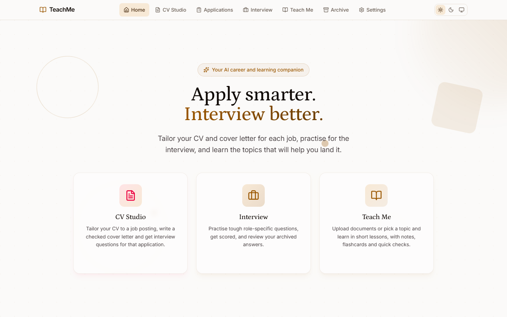
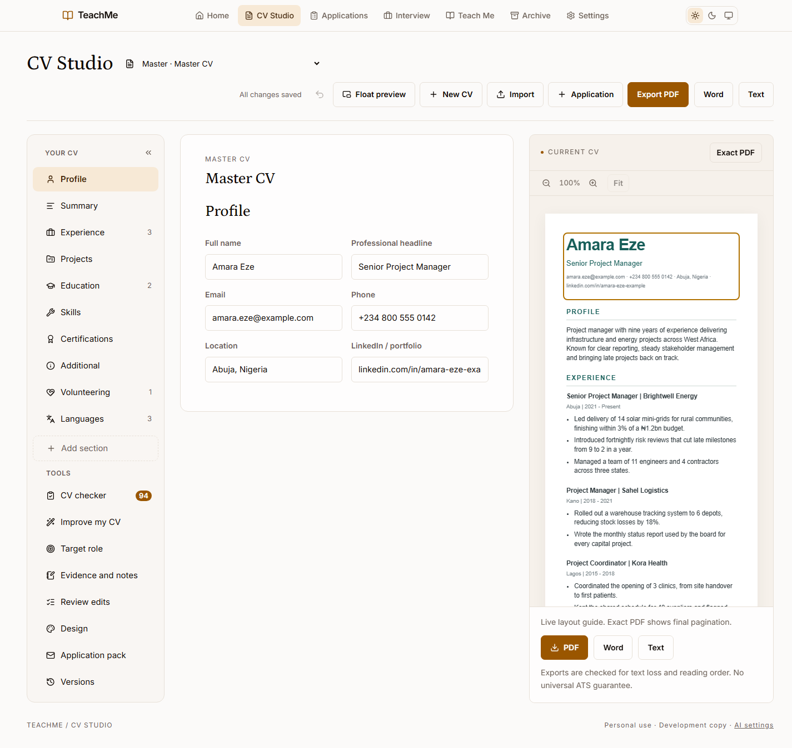
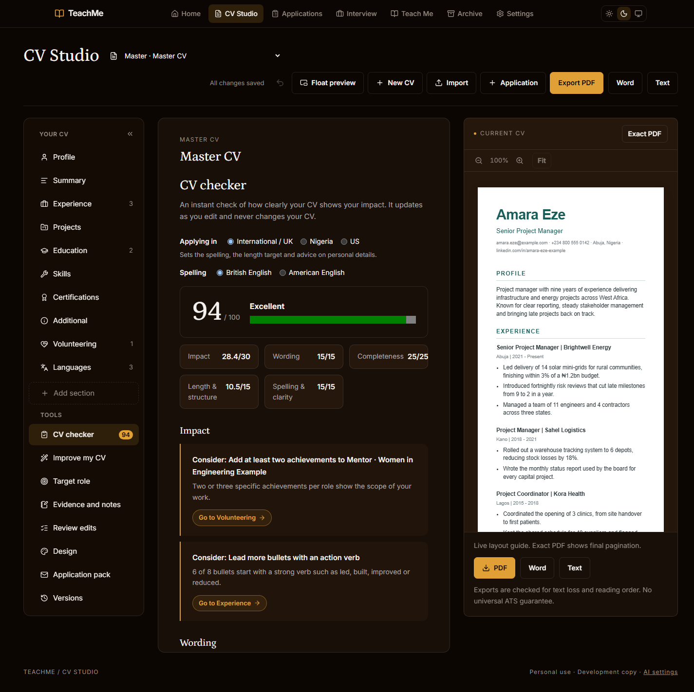
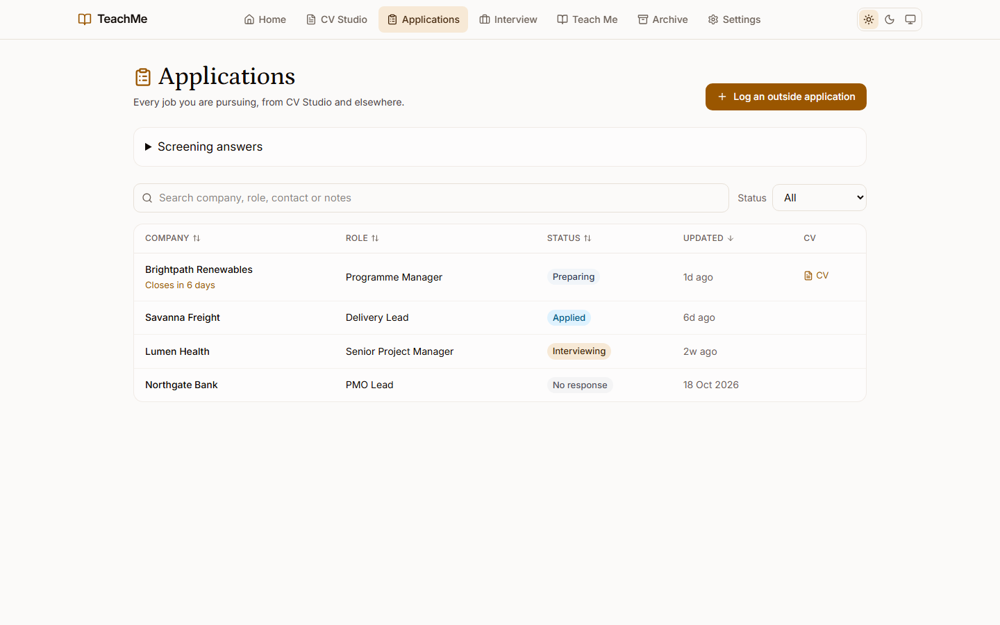
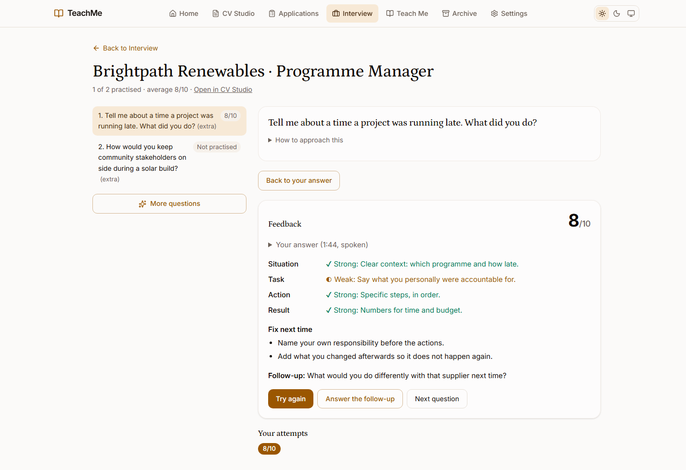
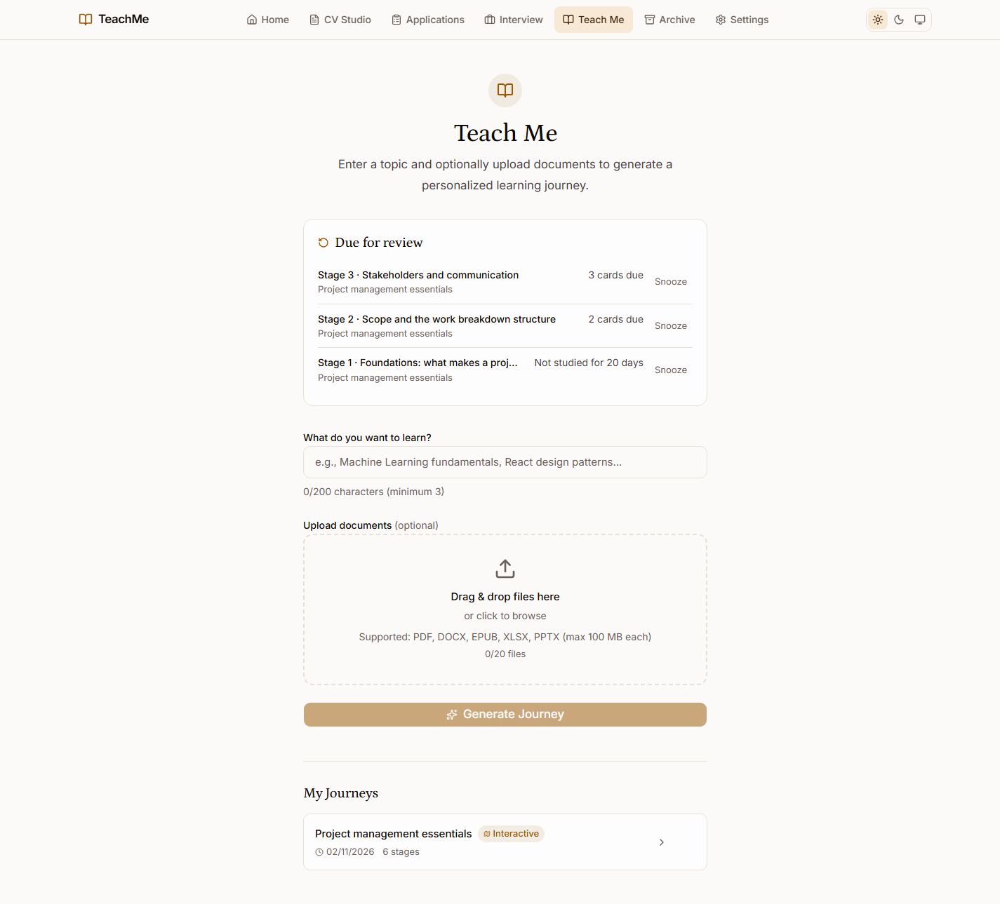
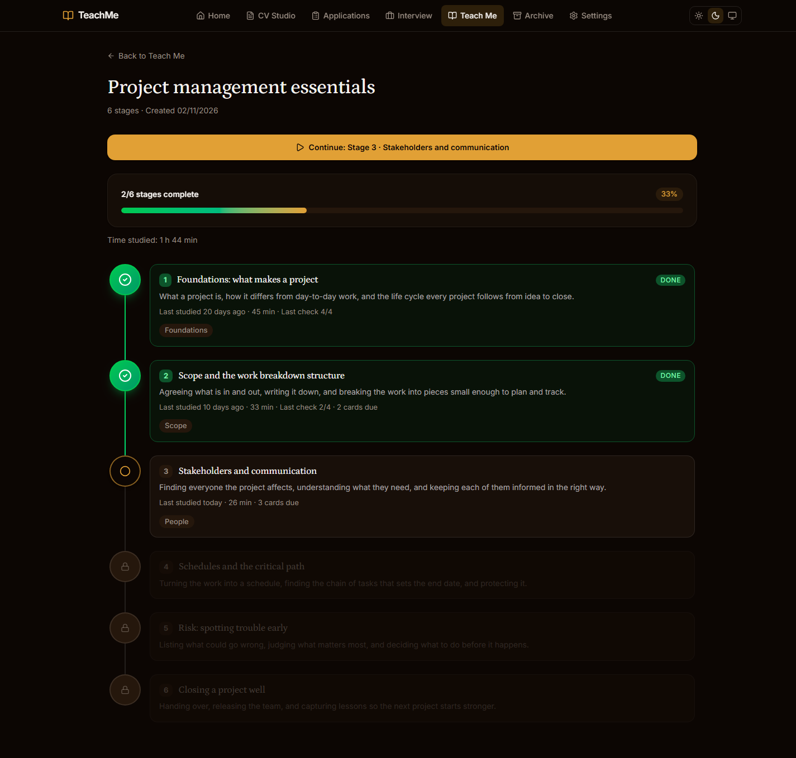
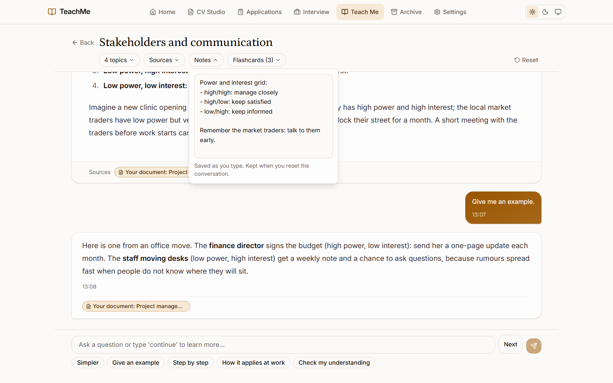
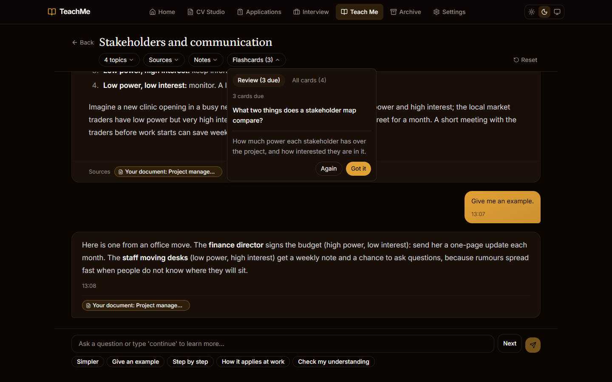

# TeachMe

TeachMe is a personal app for job hunting and for learning. It helps you build and tailor your CV, keep track of your applications, practise for interviews, and learn new topics in short lessons. It runs on your own computer and keeps your data there.



*All screenshots use made-up sample data.*

## What TeachMe does

### CV Studio: one master CV, tailored for every job

Keep everything you have done in one master CV, then make a tailored copy for each job you apply to.

- **Edit with a live preview** of the finished CV, section by section: experience, education, skills, certifications, projects, volunteering, languages and more.
- **Bring your existing CV** (PDF or Word) instead of starting from scratch.
- **CV checker**: an instant score out of 100 for impact, wording, completeness, length and spelling, with specific suggestions and a button that takes you to the place to fix. It adapts to where you are applying (international/UK, Nigeria or US) and to British or American spelling.
- **Tailor to a job ad**: paste the job description and get suggested changes that are checked against your own evidence, so nothing is invented. You accept or reject each one.
- **Improve my CV**, keyword gaps, a cover letter and likely interview questions for each application.
- **Design**: nine templates, a choice of colours and fonts, one or two columns.
- **Export** to PDF, Word or plain text, and keep saved versions to go back to.





### Applications: every job you are pursuing

- One list of every application, whether it started in CV Studio or elsewhere, with its status (preparing, applied, interviewing, offer and so on), closing date and the CV you sent.
- Reminders when a closing date is near or something is missing before you apply.
- **Screening answers**: write your standard answers (notice period, salary, right to work and so on) once and reuse them.



### Interview: practise and get scored

- **Practise for a specific CV or application**: questions based on your own experience and the job, or quick practice for any job title.
- **Type or speak your answer.** Each answer is scored out of 10 using the STAR method (situation, task, action, result), with what to fix next time and a follow-up question, just like a real interviewer.
- Try again, answer the follow-up, and keep your best answers in the archive.



### Teach Me: learn any topic in short lessons

- **Create a learning journey** from a topic, from your own documents (PDF, Word, EPUB, Excel, PowerPoint), or both. TeachMe splits it into stages and teaches each stage as a conversation, showing which document every answer comes from.
- **Quick prompts** for each lesson: explain it more simply, give an example, step by step, how it applies at work, and **Check my understanding** (a short quiz that is scored and saved).
- **Notes** for every stage, saved as you type.
- **Flashcards**: let the AI make cards from the stage, or write your own. Review them on a spaced schedule; cards you know come back less often.
- **Track your progress**: completed stages, study time, your last check score and cards due, all on the journey map.
- **Due for review**: the Teach Me page reminds you which stages need another look, and you can snooze a reminder.









### Light and dark mode, and your data stays yours

Switch between light, dark and your system setting at any time. Everything you write is stored on your computer. Only the text needed for an AI feature is sent to the AI provider you choose, and you can back up and restore your career data from **Settings**.

## What you need

- [Node.js](https://nodejs.org) 20.9 or newer (Node 24 LTS recommended). It includes `npm`.
- [Git](https://git-scm.com).
- An AI provider for the AI features: an OpenAI or Anthropic API key, or Ollama (cloud or running on your computer). You add it inside the app.

## Set up on a new computer

Run these in a terminal (on Windows: PowerShell, Command Prompt or Git Bash).

1. Get the code:

   ```bash
   git clone https://github.com/oleevaqween/teachme-app.git
   cd teachme-app
   ```

2. Install everything. This also prepares the database code automatically:

   ```bash
   npm install
   ```

   Newer versions of npm may print an "allow-scripts" warning listing a few packages. It is safe to ignore.

3. Optional settings: copy the template and fill in only what you need (every setting is optional; the file explains each one):

   ```bash
   cp .env.example .env.local
   ```

   On Windows Command Prompt use `copy .env.example .env.local` instead.

4. Create the app database (`dev.db` in the project folder):

   ```bash
   npm run db:setup
   ```

   The career database for CV Studio and Applications (`.data/career.db`) is created automatically the first time you open CV Studio.

5. Start TeachMe:

   ```bash
   npm run dev
   ```

   Then open http://localhost:3000. On Windows you can instead double-click `start-dev.bat`, which starts the app and opens the browser.

6. In the app, open **Settings** and add your AI provider.

### If you see certificate errors

On some networks (for example with a company proxy) the AI calls fail with certificate errors. Start the app with your computer's certificates trusted:

```bash
# macOS / Linux / Git Bash
NODE_OPTIONS=--use-system-ca npm run dev
```

On Windows, `start-dev.bat` already does this.

## Moving your data to another computer

Your data is not in Git, on purpose. To move it:

- **CVs, applications and interview practice**: on the old computer, open **Settings** and use **Back up your career data** to download a backup file. On the new computer, open **Settings** and use **Restore from a backup** with that file. Restore only adds what is missing; it never overwrites.
- **AI settings and Teach Me journeys** live in `dev.db`. Either add your AI provider again in **Settings**, or copy `dev.db` from the old project folder into the new one *before* you start the app there (skip step 4 if you copy it).
- **Uploaded documents** for Teach Me are in the `uploads` folder; copy it across if you want them.

## Updating

```bash
git pull
npm install
npm run db:setup
```

`npm run db:setup` only applies new database changes and keeps your data.

## Useful commands

| Command | What it does |
|---|---|
| `npm run dev` | Start TeachMe for everyday use |
| `npm run db:setup` | Create or update the app database |
| `npm test` | Run the tests |
| `npm run build` | Check that the app builds |

Built with Next.js, React, Prisma and SQLite.

## Licence

MIT. See [LICENSE](LICENSE).
